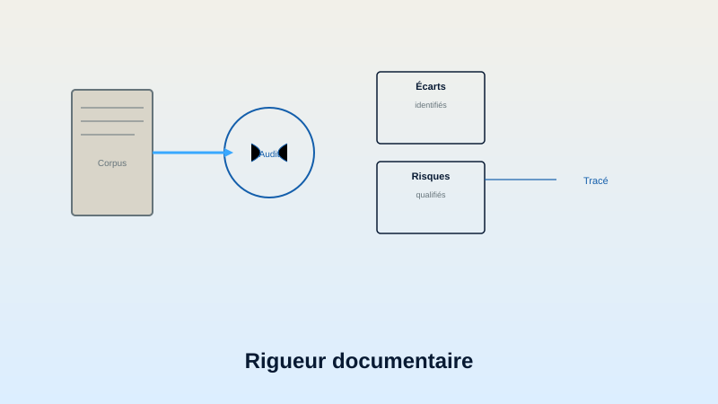

# MVDG — public showcase


**MVDG** signifie **Méthode de Validation Documentaire Gouvernée**.

Elle transforme un corpus documentaire hétérogène en constats structurés,
traçables et vérifiables, sans extrapoler au-delà des pièces disponibles.

Ce dépôt est une **preuve publique allégée**. Il présente la doctrine, le flux de
contrôle, un cas réel sous forme strictement agrégée et un exemple entièrement
fictif. Il ne contient ni dossier client, ni rapport individuel, ni donnée
personnelle, ni matrice opérationnelle propriétaire.

> Écrire la règle avant de produire la première ligne.

## Ce que démontre la MVDG

- la définition préalable de ce qui constitue une preuve ;
- la primauté de la pièce directement lue sur un index ou une inférence ;
- la séparation entre fait, réserve, incertitude et pièce manquante ;
- le rattachement de chaque constat à sa source ;
- la conservation visible des limites et des corrections ;
- une validation humaine finale avant toute diffusion.

## Flux public de la méthode



Le flux détaillé en onze étapes est décrit dans
[`docs/METHOD_OVERVIEW.md`](docs/METHOD_OVERVIEW.md).

## Preuve agrégée

Un lot réel anonymisé a permis de vérifier publiquement les éléments suivants :

| Indicateur | Résultat public |
|---|---:|
| Dossiers relus directement sur pièces sources | 9 |
| Rapports individuels produits en version contrôlée | 9 |
| Erreurs factuelles antérieures corrigées et documentées | 3 |
| Preuves tierces avec quantité exactement concordante | 7/9 |

Ces chiffres ne permettent pas d’identifier le client, les dossiers ou les
documents sources. Leur portée et leurs limites sont documentées dans
[`docs/DEMONSTRATED_CASE.md`](docs/DEMONSTRATED_CASE.md).

## Exemple public

[`examples/synthetic_case.json`](examples/synthetic_case.json) illustre, sur un
cas fictif, la différence entre :

- un contrôle réussi ;
- un écart prouvé ;
- une réserve imposant une revue humaine.

L’exemple ne reproduit aucun dossier réel.

## Relation avec AXIOM

La MVDG applique au document la même doctrine qu’AXIOM applique aux missions
d’agents : périmètre borné, règles écrites avant traitement, validations
explicites, trace d’audit et décision humaine. Voir
[`docs/AXIOM_RELATION.md`](docs/AXIOM_RELATION.md).

## Vérification locale

Le paquet public se vérifie sans dépendance externe :

```sh
python3 verify_showcase.py
```

Résultat attendu :

```text
MVDG_SHOWCASE_CHECK=PASS files=11 synthetic_findings=3 public_metrics=4
```

## Frontière publique

Ce dépôt n’est :

- ni une certification ;
- ni une norme officielle ;
- ni une accréditation ;
- ni un moteur d’audit autonome ;
- ni la publication intégrale de la méthode opérationnelle ;
- ni une autorisation de réutiliser des contenus clients ou propriétaires.

La frontière complète figure dans
[`docs/PUBLIC_BOUNDARY.md`](docs/PUBLIC_BOUNDARY.md).

## Liens

- [Présentation MVDG sur TechToolGeek](https://techtoolgeek.com/mvdg.html)
- [Showcase public AXIOM](https://github.com/franckygoes/axiom-showcase)

## Auteur

Franck Melka — TechToolGeek

Tous droits réservés. Aucune licence open source n’est accordée par ce dépôt.
